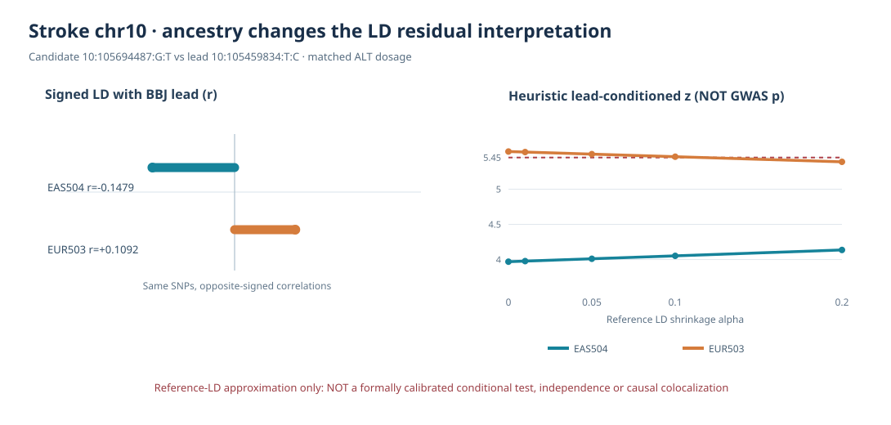

# IS: matched 1000G EAS504 vs EUR503 LD lead-residual ancestry sensitivity

**Research audit:** 2026-10-11 KST. **Claim boundary:** externally referenced LD diagnostic only — **NOT a formally calibrated conditional BBJ GWAS, not GTEx/QTD donor LD, not SuSiE fine-mapping, and not a second causal signal.**

## Primary question

A previous EUR503-only lead-conditioned approximation identified BBJ chr10 SNP `10:105694487:G:T` as an apparent residual candidate under some shrinkage settings. Would the same pattern persist with the *East Asian* population reference relevant to BBJ IS?

**Answer: no.** With the independently matched 1000G EAS504 panel, the candidate–lead LD changes sign and the heuristic residual drops below the preselected threshold for **all five** shrinkage settings.

### Exactly matched lead–candidate genotype comparison

- BBJ GWAS lead GRCh37: `10:105459834:T:C`, GWAS `z=-6.130469`.
- EUR-only exploratory residual candidate GRCh37: `10:105694487:G:T`, marginal BBJ `z=+4.832637`.
- The SNP/allele keys were identical across EAS504 and EUR503 VCF/PGEN exports; all genotype counts converted to genomic GRCh37 **ALT** dosage before computing signed Pearson r.

| Metric | 1000G EAS504 | 1000G EUR503 |
|---|---:|---:|
| Individuals | 504 | 503 |
| Genotypes observed for both SNPs | 504/504 | 503/503 |
| Candidate ALT EAF | 0.407738 | 0.347913 |
| GWAS lead ALT EAF | 0.563492 | 0.393638 |
| Lead–candidate **signed r** | **−0.147903** | **+0.109206** |
| r² | 0.021875 | 0.011926 |
| Heuristic residual z, alpha=0 | 3.9696 | 5.5352 |
| Heuristic residual z, alpha=0.05 | 4.0111 | 5.4983 |
| Heuristic residual z, alpha=0.20 | 4.1363 | 5.3888 |
| Number of five settings with abs(z)≥5.45 | **0** | **4** |

The **observed sign reversal** was validated independently against the pre-existing EAS `BBJ_IS_L002.1KG_EAS.GRCh37` PGEN: both lead and candidate ALT dosage vectors were **identical for all 504 individual IDs** after export and allele conversion, ruling out a newly introduced remote VCF export error for these SNPs.

**Caution:** small lead–candidate r values may be influenced by population differences and sample uncertainty. Opposite signs are observed facts, not sufficient proof of a mechanistic ancestry-specific LD effect or independent causality.

## Entire-locus ancestry-matched SNP comparison

The earlier EAS PGEN did contain the candidate but covered only 1,401 chr4 and 1,472 chr10 variants from the new ABF set. We therefore made two **bounded 1000G Phase 3 EAS504 GRCh37 extractions over exactly the same UCSC regional intervals previously used for EUR503**, using the locally verified EAS504 donor IID list. **No imputation** and no change to BBJ or QTL sources.

| Metric | chr4 FGF5/C4orf22 | chr10 CALHM2/NEURL |
|---|---:|---:|
| Exact allele-identical SNPs in BOTH EAS/EUR | 2,834 | 2,828 |
| EAS / EUR subjects | 504 / 503 | 504 / 503 |
| Monomorphic EAS SNPs | 10 | 50 |
| Monomorphic EUR SNPs | 9 | 13 |
| Lead r defined in both panels | 2,815 | 2,765 |
| **Opposite-signed lead r with abs(r)≥0.1 in both** | 50 | 91 |
| SNPs with abs(r²_EAS−r²_EUR)>0.2 | 17 | 60 |

Numerical thresholds are descriptive. Genetic relatedness, reference-ancestry diversity and possible finite-panel sampling uncertainty prevent calling these independent causal signal counts. Monomorphic variants were not assigned r=0. These are **unique SNPs per locus**, not the separate four-gene association totals.

### Same-SNP ancestry-conditional screening

For every shared, polymorphic reference SNP except the lead, the heuristic `z_residual=(z_j−r_alpha*z_lead)/sqrt(1−r_alpha²)`, with `r_alpha=(1−alpha)*r_reference`, was evaluated for `alpha={0,0.01,0.05,0.10,0.20}`. It does not account for BBJ in-sample covariance uncertainty, and the returned z is **not a formal conditional p-value**.

| Locus | Common evaluable SNPs per alpha | EAS settings: number with abs(z)≥5.45 | EUR settings: number with abs(z)≥5.45 |
|---|---:|---|---|
| chr4 | 2,814 | 0, 0, 0, 0, 0 | 0, 0, 0, 0, 0 |
| chr10 | 2,764 | **0, 0, 0, 0, 0** | 1, 1, 1, 1, 0 |

This controls SNP selection and effect-allele orientation: **the only comparison dimension is which ancestry reference's signed LD is used**. Across the inspected EAS panel there is no candidate exceeding the earlier heuristic threshold; in EUR the prior single candidate remains shrinkage-sensitive.

### Figure

## Reproducibility and provenance

- Matched EAS504 regional VCF/PGEN: `/srv/is-analysis/results/is/audits/is_priority4_eur503_eas504_conditional_20261011_v1/`
- EUR503 regional genotype exports: `/srv/is-analysis/results/is/audits/is_priority4_eur503_fullcis_signed_ld_qc_20261011_v1/`
- Original BBJ beta/SE, QTD eQTL allele-harmonized matched set: `/srv/is-analysis/results/is/audits/is_priority4_ebi_bbj_abf_pilot_20261011_v2/`
- Full-locus outputs: `/srv/is-analysis/results/is/audits/is_priority4_eas_eur_matched_reference_20261011_v1/`:
  - `IS_PRIORITY4_EAS_EUR_COMMON_SNP_LEAD_LD.tsv`
  - `IS_PRIORITY4_EAS_EUR_LEAD_LD_SUMMARY.tsv`
  - `IS_PRIORITY4_EAS_EUR_APPROX_CONDITIONAL_SCREEN.tsv`
  - `IS_CHR10_105694487_EAS_EUR_CANDIDATE_SENSITIVITY.tsv`
  - `IS_PRIORITY4_EAS_EUR_REFERENCE_CONDITIONAL_MANIFEST.json`
- Code: `scripts/is/audit_is_priority4_eas_eur_reference_conditional.py`
- Figure: `scripts/is/render_is_priority4_ancestry_candidate_sensitivity.py`
- Regression checks: `tests/test_is_priority4_eas_eur_reference_conditional.py`

No original historical 646 coloc PP.H4 posteriors, newer EBI–BBJ 120 ABF sensitivity fits or 2,225 positional discovery candidate genes were modified.

## Next defensible scientific gate

For genuinely independent signals, **study-appropriate in-sample BBJ East Asian GWAS LD, conditional summary association method, and their allele/haplotype alignment** must replace the current EUR/EAS reference-only one-lead approximation. The EBI molecular donor-level LD, expression-effective QTL sample count and tested variant universe remain separate colocalization constraints. A further observationally feasible step is to compare EAS504 versus a JPT-only 1000G panel at the candidate while clearly acknowledging much smaller JPT sample size and stochastic uncertainty. No formal SuSiE-coloc can be claimed from this evidence alone.
