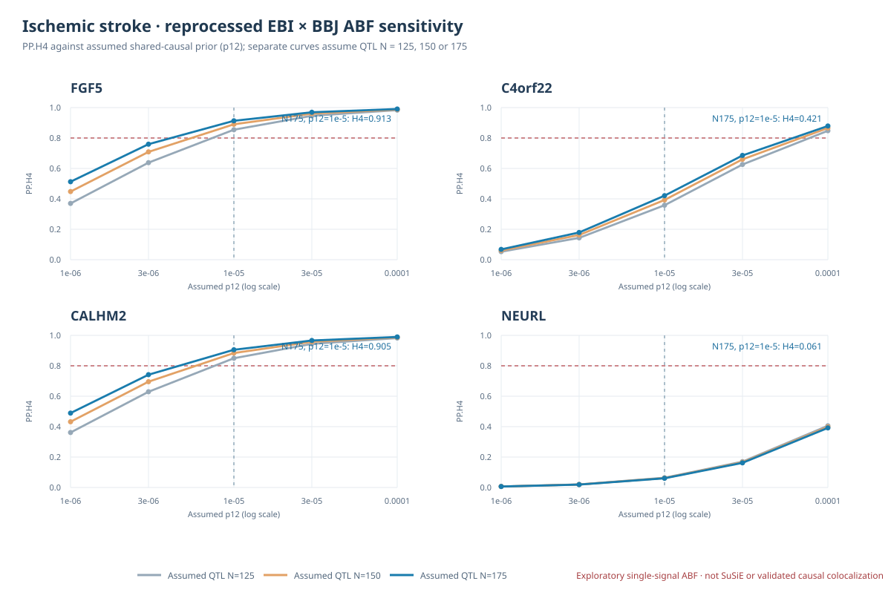
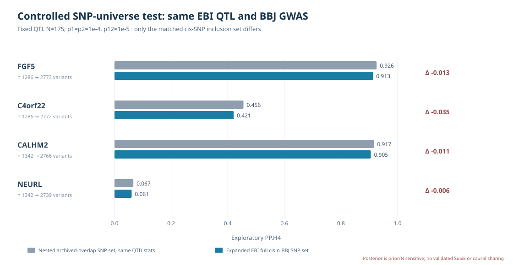

# IS priority-four: exploratory complete-cis EBI eQTL × BBJ IS coloc.abf grid

**Executed:** 2026-10-11 KST. **Status:** new independent exploratory coloc.abf sensitivity grid from EMBL-EBI eQTL Catalogue QTS000015/QTD000161 reprocessing and BBJ Japanese ischemic stroke GWAS.

## Why this is distinct from archived GTEx V8 results

The historical 646 archived coloc.abf assays and their posteriors are **preserved unchanged**. The inherited source labeled `GTEx_V8` has not been independently authenticated as original FastQTL production, and its assumed p12 historical execution metadata are not independently confirmed. This work instead constructs **new, versioned source data**:

- eQTL Catalogue tissue **Brain Cerebellar Hemisphere** (`QTD000161`) complete tested cis gene–SNP universes (**FGF5 5,511; C4orf22 5,490; CALHM2 4,868; NEURL 4,820**).
- The Japanese **BBJ IS**, full **13,435,531-row** original processed GWAS source; we re-scan to recover original beta/SE/p and independently verify they reproduce the allele-harmonized BBJ audit data.
- GRCh38 eQTL variant -> `hg38ToHg19` chain -> GRCh37 reference FASTA -> GRCh37 genomic REF/ALT. Molecular QTL beta is on the Catalogue **ALT** allele per provider schema; BBJ effect beta and EAF are reoriented to genomic ALT only when the original effect allele explicitly matches REF or ALT.
- **5,666 distinct genomic SNPs / 11,050 gene–SNP association inputs**, after excluding variants with insufficient FASTA/allele verification, no exact BBJ GWAS match, or palindromic A/T and C/G pairs. SNP count is not the number of independent instrumental variants. The original 20,689 cis eQTL gene–SNP records are untouched.

## Statistical assumptions — important publication exclusions

Method: `coloc::coloc.abf` on exactly matched GWAS/QTL SNP keys and source beta/varbeta, with EBI molecular MAF (from AC/AN) and BBJ GWAS EAF adjusted to MAF. **BBJ case-control** parameters `N=174686` and `case fraction s=22664/174686` mirror the prior BBJ replays; they remain GWAS study metadata assumptions and must be confirmed against frozen BBJ publication before a publication claim.

**QTL effective expression-association N is not independently authenticated.** Catalogue source field `AN` is a variant-specific genotype allele count, often up to 350, and `AN/2 <=175` is **not by itself a valid expression-association N**. We therefore run **three explicit sensitivity scenarios**, with quant-trait `N ∈ {125,150,175}`, rather than asserting that 175 is the uniquely correct QTL N. In each run `coloc.abf` estimates quantitative-trait `sdY` from source betas/SEs/MAFs and assumed N; exact phenotype normalization/sample cohort details still require verification.

All runs hold `p1=p2=1e-4` and vary the *new explicitly assumed* shared-causal prior `p12 ∈ {1e-6,3e-6,1e-5,3e-5,1e-4}`. These are **15 scenarios per gene × 4 genes = 60 new ABF runs**. They assume **at most one causal variant per trait** within an analyzed locus, are not conditional/multi-signal colocalization, and do not use an LD matrix. The EBI molecular donors' signed LD is unverified. BBJ and GIGASTROKE are not treated as independent genetic replications.

## Results: baseline scenario

Under exploratory `QTL N=175, p12=1e-5`:

| Gene | Exact non-palindromic matched SNPs | New EBI×BBJ PP.H3 | New EBI×BBJ PP.H4 | Historical inherited-source PP.H4 — **different model** |
|---|---:|---:|---:|---:|
| **FGF5** | 2,773 | 0.0297 | **0.9132** | 0.7787 |
| **C4orf22** | 2,772 | 0.1272 | **0.4209** | 0.6599 |
| **CALHM2** | 2,766 | 0.0267 | **0.9054** | 0.7977 |
| **NEURL** | 2,739 | 0.1899 | **0.0605** | 0.6776 |

**Do not interpret the difference from the historical H4 as a delta caused by broader cis SNP coverage.** QTL association model, included SNPs, some excluded ambiguous alleles, genotype provenance, N assumptions and priors are different. Only a controlled same-source nested-SNP comparison can isolate the effect of expanding cis coverage.

## Every-run sensitivity

| Gene | New PP.H4 range across **all 15 scenarios** | N=125, p12=1e-5 | N=150, p12=1e-5 | N=175, p12=1e-5 | N=175, p12=1e-6 | N=175, p12=1e-4 |
|---|---:|---:|---:|---:|---:|---:|
| FGF5 | **0.370–0.991** | 0.854 | 0.890 | 0.913 | 0.513 | 0.991 |
| C4orf22 | **0.053–0.879** | 0.358 | 0.393 | 0.421 | 0.068 | 0.879 |
| CALHM2 | **0.361–0.990** | 0.850 | 0.884 | 0.905 | 0.489 | 0.990 |
| NEURL | **0.006–0.406** | 0.064 | 0.062 | 0.061 | 0.006 | 0.392 |

For FGF5, CALHM2 and C4orf22 the prior grid crosses PP.H4=0.8, so classification depends on assumed `p12` (and, less dramatically for these data, N). NEURL is below 0.8 in every tested scenario. **Posterior sensitivity to priors and unverified QTL N is a scientific finding about the model, not a genetic causality claim.** Very high p12=1e-4 is an intentionally strong shared-causality prior and should not be used as the preferred analysis solely because it inflates PP.H4.

## Sensitivity Figure

## Code and source chain

1. `scripts/is/prepare_is_priority4_ebi_bbj_abf_pilot.py` constructs 11,050 nonpalindromic allele-exact candidate association records, without inventing GWAS SE from beta/p.
2. `scripts/is/complete_is_priority4_ebi_bbj_abf_input.py` rescans all 13,435,531 canonical BBJ records for source SE and independently validates beta/p/ALT EAF within a strict numeric tolerance.
3. `scripts/is/run_is_priority4_ebi_bbj_abf_sensitivity.R` performs 60 separate `coloc.abf` fits and emits their five hypothesis posteriors and maximum per-variant H4 posterior. The script rejects missing/invalid alleles and posterior distributions that fail to sum to 1.
4. `scripts/is/audit_is_priority4_ebi_bbj_abf_grid.py` verifies all 60 scenarios, genes, posterior constraints, p12-monotonicity and frozen SNP cardinality; emits a stable manifest with checksums.
5. `scripts/is/render_is_priority4_ebi_bbj_abf_prior_n_figure.py`, regression tests `tests/test_is_priority4_ebi_bbj_abf_pilot.py`.

Read-only server outputs:
`/srv/is-analysis/results/is/audits/is_priority4_ebi_bbj_abf_pilot_20261011_v1/` pre-SE candidate table;
`.../is_priority4_ebi_bbj_abf_pilot_20261011_v2/` exact GWAS source-validated SE inputs;
`.../is_priority4_ebi_bbj_abf_pilot_20261011_v3/` all 60 R runs;
`.../is_priority4_ebi_bbj_abf_pilot_20261011_v4/` audit summary and SHA256 manifest.

No original GTEx_v8 source file, prior legacy H4/646 posterior, or IS **2,225-gene** positional discovery universe was modified.

## Next scientific tasks

**Most important next:** compare the **same reprocessed QTD000161 × BBJ source** under old 1,694/1,583 intersected SNP subsets versus 2,773/2,772/2,766/2,739 new coverage at fixed N and p12, with allele-consistent SNP matching and identical per-study data. This isolates one main hypothesis: whether the expanded SNP universe itself changes PP.H4.

For formal multi-signal colocalization: authenticate QTD tissue's actual expression-association effective N, obtain donor-cohort QTL LD if permitted (or clearly specify EUR reference LD proxy assumptions), test conditional independent signals and publish prior sensitivity. Candidate-gene inference remains exploratory until those gates pass.

## Controlled nested-SNP comparison — EXECUTED, additional 60 scenarios

The controlled comparison recommended above was also executed. We held **the exact EBI QTL/BBJ GWAS β, SE, AF and per-SNP allele orientation**, as well as the same three assumed QTL N values and five prior values, fixed. Only SNP inclusion changed:

- **Nested:** previously archived common SNP overlap *that is also present in EBI QTD000161* and passed the new exact BBJ/FASTA and non-palindromic gate (**FGF5/C4orf22 1,286; CALHM2/NEURL 1,342**). This is **not** an attempt to reuse archived GTEx QTL coefficients.
- **Expanded:** every new EBI QTD000161 full-cis tested SNP with same QC, exact BBJ match and non-palindromic gate (**2,773 / 2,772 / 2,766 / 2,739**).

| Gene | Same-source nested n | Expanded n | Nested H4 | Expanded H4 | **Expanded − nested H4** |
|---|---:|---:|---:|---:|---:|
| FGF5 | 1,286 | 2,773 | 0.9260 | 0.9132 | **−0.0128** |
| C4orf22 | 1,286 | 2,772 | 0.4556 | 0.4209 | **−0.0347** |
| CALHM2 | 1,342 | 2,766 | 0.9166 | 0.9054 | **−0.0112** |
| NEURL | 1,342 | 2,739 | 0.0666 | 0.0605 | **−0.0061** |

Reference scenario `N=175, p12=1e-5`. Across **all 15 paired N/p12 settings for each gene** (60 paired contrasts), the expanded input produced lower H4 than the same-source nested input, with the larger reduction of ~0.035 at C4orf22. The EBI molecular QTL and GWAS statistical inputs for each retained SNP were **bitwise-equivalent TSV row fields**, checked by nested-subset regression test. This supports the narrow conclusion that expanding the EBI–BBJ SNP universe **slightly lowers H4 in this particular single-signal ABF model**, rather than accounting for the large changes between *historical* and *new* source models.

It does not establish causal independence, show EBI and historic GTEx QTL algorithms are equivalent, or prove that one SNP collection is universally optimal. `coloc.abf` assumes at most one causal signal per trait; adding correlated tags can redistribute modeled hypotheses.

### Controlled model artifacts and tests

- `scripts/is/prepare_is_priority4_ebi_bbj_nested_snps.py` prepares only the exactly matching SNP subset from the frozen 11,050-row source.
- `scripts/is/run_is_priority4_ebi_bbj_abf_sensitivity.R INPUT OUT ARCHIVED_NESTED` performs another 60 identical-statistics, different-SNP-count scenarios, with strict expected per-gene SNP counts.
- `scripts/is/audit_is_priority4_ebi_bbj_nested_abf.py` pairs and checks both 60-scenario grids, effect-model assumptions, subset cardinality and archived-analysis non-modification flags.
- `scripts/is/render_is_priority4_nested_abf_control_figure.py` and `tests/test_is_priority4_ebi_bbj_nested_abf.py`.

Server results (nonoverwriting):
`/srv/is-analysis/results/is/audits/is_priority4_ebi_bbj_nested_fixedsource_20261011_v1/` (frozen nested source),
`.../is_priority4_ebi_bbj_nested_fixedsource_20261011_v2/` (60 nested ABF runs),
`.../is_priority4_ebi_bbj_nested_control_20261011_v1/` (60 paired comparisons, per-gene summary, SHA256 manifest).
