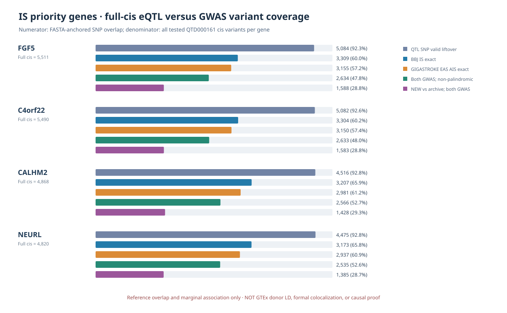

# IS priority-four: EBI complete cis × BBJ/GIGASTROKE exact-SNP GWAS evidence

**Audit date:** 2026-10-11 KST. **Status:** GWAS–molecular QTL shared tested SNP discovery only. **No coloc, MR, SuSiE, causal-gene confirmation, or independent EAS replication.**

## Sources and scope

1. **Molecular QTL source:** EMBL-EBI eQTL Catalogue `QTS000015/QTD000161` reanalysis of GTEx Brain – Cerebellar Hemisphere. This is **not authenticated as the original upstream QTL model** underlying archived BBJ/GTEx coloc PP.H4. The complete gene-specific cis tested variant lists were reconstructed in a previous audit against independently published `permuted.tsv.gz:n_variants`. Current input contains **20,689 gene–SNP records** across FGF5/C4orf22/CALHM2/NEURL. Those records need not be 20,689 unique genetic variants.
2. **BBJ IS:** `/srv/is-analysis/data/is/processed/japan/bbj/BBJ_IS_GRCh37.canonical.tsv.gz`, scanned **13,435,531** source rows.
3. **GIGASTROKE EAS AIS:** `/srv/is-analysis/data/is/processed/gigastroke/eas/GCST90104545_AIS_GRCh37.canonical.tsv.gz`, scanned **6,725,216** source rows. The original raw/source FASTA allele recoding rules had been reviewed by existing `audit_is_eas5_giga_raw_canonical_fastaref.py`, reused here. Some older GWAS IDs record `other:effect` rather than canonical GRCh37 `REF:ALT`; that historical form **must not** be used as the matched variant ID.
4. **Variant mapping:** EBI GRCh38 chr:pos:REF:ALT -> UCSC `hg38ToHg19.over.chain` -> independent `human_g1k_v37.fasta` allele-reference check -> matching canonical GWAS `chr:pos:REF:ALT` with verified effect/other allele set. Reject unverified/ambiguous nonbiallelic SNPs. Where exact, GWAS beta and allele frequency are oriented to reference **ALT** and the molecular QTL estimate is kept as the original EBI model. Palindromic A/T or C/G SNPs are flagged for review and not used in threshold joint statistics.

## Results: four gene–tissue assays

| Gene | EBI entire tested cis SNPs | FASTA37 verified biallelic SNPs | Exact BBJ | Exact EAS AIS | Exact both | Exact both nonpalindromic |
|---|---:|---:|---:|---:|---:|---:|
| FGF5 | 5,511 | 5,084 | 3,309 | 3,155 | 3,151 | 2,634 |
| C4orf22 | 5,490 | 5,082 | 3,304 | 3,150 | 3,146 | 2,633 |
| CALHM2 | 4,868 | 4,516 | 3,207 | 2,981 | 2,980 | 2,566 |
| NEURL | 4,820 | 4,475 | 3,173 | 2,937 | 2,937 | 2,535 |

Not all full tested cis variants are SNPs that can be unambiguously chain-lifted and FASTA checked; excluded SNPs are **unresolved input state, not GWAS negatives**. Raw GWAS sources were scanned study-wide once, not limited to historical rsID panels. SNP evidence table retains all 20,689 input rows, including non-validated entries with explicit status.

### Previously excluded from the old matched BBJ–QTL input

| Gene | EBI QTL SNPs absent from archived narrow SNP input | Those with BBJ exact GWAS | Those with GIGASTROKE exact GWAS | Those in both GWAS |
|---|---:|---:|---:|---:|
| FGF5 | 3,943 | 1,741 | 1,592 | 1,588 |
| C4orf22 | 3,922 | 1,736 | 1,587 | 1,583 |
| CALHM2 | 3,315 | 1,654 | 1,428 | 1,428 |
| NEURL | 3,267 | 1,620 | 1,385 | 1,385 |

The old archived source has **1,694** chr4 or **1,583** chr10 matched variant IDs per gene; of those, exactly **1,568** and **1,553** intersected the different EBI reprocessing. These additional records are **new relative to the older input's QTL+GWAS intersection**; they are NOT extra variants in a verified original GTEx FastQTL testing universe, new independent association discoveries, nor a reason to overwrite the 646 historical coloc results.

### Joint marginal signals requiring follow-up, NOT colocalization

Exploratory rule: non-palindromic, same REF/ALT-matched SNP, `QTD000161 nominal QTL p <1e-4`, and the relevant AIS GWAS `p <5e-8`. The studies, allele effects and test multiplicity are not coupled by this rule.

| Gene | Variant (GRCh37) | EBI QTL nominal p | BBJ IS p | GIGASTROKE EAS AIS p | Threshold interpretation |
|---|---|---:|---:|---:|---|
| FGF5 | 4:81,182,554:T:C | 3.85237e-5 | 1.21190e-8 | 2.888e-8 | QTL and both stroke GWAS nominally meet given thresholds |
| CALHM2 | 10:105,447,782:A:G | 4.01282e-5 | 2.29341e-9 | 1.332e-6 | QTL + BBJ only |
| CALHM2 | 10:105,459,834:T:C | 3.27466e-5 | 8.76202e-10 | 7.792e-7 | QTL + BBJ only |

**Caution:** FGF5/CALHM2 QTL marginal signals need study-specific cis multiple-testing and conditioning. Their shared SNP p-value overlap does not mean an identical causal variant; BBJ and GIGASTROKE cohorts/traits can overlap and are not assumed independent replication. The EBI QTL can have another more significant variant in its fully tested cis region.

## Figure

The figure's denominators are EBI whole cis variant counts; the five bars are **overlapping subsets**, not five mutually exclusive categories. No percentage is interpreted as a posterior probability.

## Reproducibility and inference gate

- Code: `scripts/is/audit_is_priority4_fullcis_bbj_giga_gwas_overlap.py`
- Plot: `scripts/is/render_is_priority4_fullcis_gwas_coverage.py`
- Test: `tests/test_is_priority4_fullcis_bbj_giga_gwas_overlap.py`
- Source: `/srv/is-analysis/results/is/audits/is_priority4_qtd_full_cis_reconstruction_20261011_v2/IS_PRIORITY4_EBI_REPROCESSED_FULL_CIS_VARIANTS.tsv`
- New server outputs: `/srv/is-analysis/results/is/audits/is_priority4_fullcis_bbj_giga_snp_exact_20261011_v1/` with 20,689 annotated SNP–gene rows, 4-row summary and manifest.

**Scientific next gates:** verify the particular original inherited `GTEx_V8` cis QTL analytic source and effect allele convention; establish EBI QTL donor cohort-appropriate signed LD or explicit ancestry-sensitive reference limitations; run conditionally independent colocalization only with consistent study-wide tested SNP intersection and documented priors. The full parent IS discovery universe **2,225 genes** remains unchanged.
