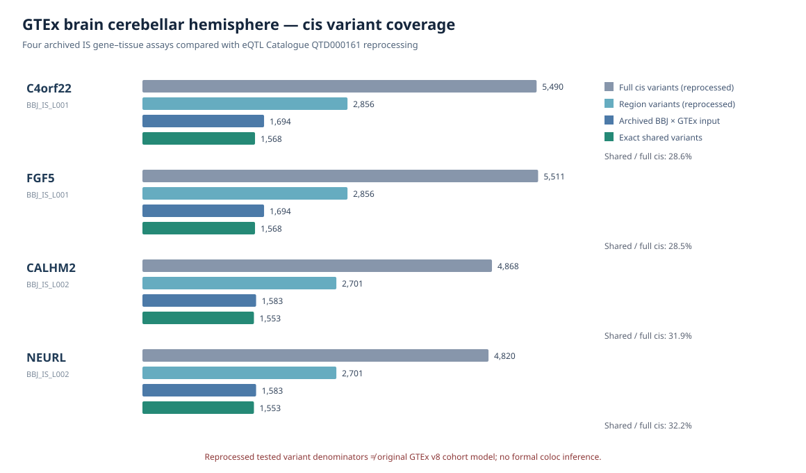

# IS — GTEx-origin QTL analysis methods and effect-allele/source audit

**Audited 2026-10-11 KST. Scope:** FGF5, C4orf22, CALHM2 and NEURL in cerebellar-hemisphere tissue. The complete discovery universe remains **2,225 candidate genes**; no posterior or original archived source file has been altered.

## Source authentication must precede scientific interpretation

The original inherited SNP summaries have a dataset key `GTEx_V8__Brain_Cerebellar_Hemisphere`, with columns such as `molecular_trait_object_id`, `molecular_trait_id`, `maf`, `ac`, `an`, `beta`, `se`. These names closely resemble the **eQTL Catalogue** standardized nominal-QTL schema. Therefore the key **GTEx_V8 does not independently authenticate** that the inherited association model is precisely the original GTEx Consortium FastQTL run. We have numerical ABF reproduction, but historical upstream QTL URL/version/processing and original p12 provenance remain unauthenticated. Until independent source metadata is found, describe the former as **inherited GTEx-v8-labeled QTL source**, not proven canonical GTEx V8 FastQTL all-pairs dataset.

**Documented methods:** GTEx V7/V8 consortium pipeline ([Broad gtex-pipeline QTL README](https://github.com/broadinstitute/gtex-pipeline/blob/master/qtl/README.md)) normalizes expression from TMM counts with inverse-normal transformation and applies FastQTL with a 1 Mb cis window and covariates. The [eQTL Catalogue methods](https://www.ebi.ac.uk/eqtl/Methods/) describe a distinct unified process including conditional quantile normalization, principal components, QTLtools and fine-mapping; notably the Catalogue describes testing ±1 Mb from the gene start (its documented convention). The particular earlier QTD000161 release's run version cannot be fully reconstructed from the current methods landing page, so do not assert a specific step caused an observed per-SNP disagreement without its frozen run manifest.

**Effect allele convention:** The Catalogue [data access guide](https://www.ebi.ac.uk/eqtl/Data_access/) explicitly states ALT is the effect allele in its released summaries and warns that one variant may appear multiple times under different rsIDs. Its columns documentation: [eQTL Catalogue data schema](https://github.com/eQTL-Catalogue/eQTL-Catalogue-resources/blob/master/tabix/Columns.md).

## Genotype-annotation consistency in exact shared SNPs

We compared source `variant_id_hg38` with QTD000161 `chromosome:position:REF:ALT`, not just rsID. We require same `AN`, legal genotype counts and MAF to six-digit rounding. ALT-count complement relationships were *observed*, **not used to flip any regression beta**.

| Gene | Exact shared SNPs | Identical AN | Identical MAF (tolerance 2e-6) | Identical AC | Complementary AC = AN − AC | QTL beta direction agreement |
|---|---:|---:|---:|---:|---:|---:|
| FGF5 | 1,568 | 1,568 | 1,568 | 1,145 | 423 | 77.2% |
| C4orf22 | 1,568 | 1,568 | 1,568 | 1,145 | 423 | 80.0% |
| CALHM2 | 1,553 | 1,553 | 1,553 | 1,283 | 270 | 78.7% |
| NEURL | 1,553 | 1,553 | 1,553 | 1,283 | 270 | 59.2% |
| **Total gene–SNP pair observations** | **6,242** | **6,242** | **6,242** | **4,856** | **1,386** | See per gene |

**Important denominators:** 6,242 *gene–variant associations*, **not 6,242 independent variants**. FGF5 and C4orf22 share 1,568 positional SNPs and CALHM2 and NEURL share 1,553, totaling 3,121 unique SNP IDs across loci. Source `ac` is always at or below half of `an` for these exact overlaps; Catalogue `ac` is not always so. This is consistent with **inherited minor-count versus Catalogue ALT-count representation** for these records, but source semantics must be authenticated before declaring every inherited `ac` as MAF-based. MAF and `AN` matching alone also do **not prove participant identities or association-model comparability**.

For instance the exact reference variant chr4:79,759,933:G:C has inherited `AC=173/AN=350`, Catalogue `AC=177/AN=350`, and **MAF=0.494286 on both sides**. Its nominal QTL p and β differ despite the compatible allele frequencies. The 1,386 complementary AC cases are **not evidence that archived β requires a sign flip**. Automatic sign flipping based on `ac` alone would be statistically unjustified.

## Why the SNP overlap matters for colocalization

This is a different question from whether the *genotype frequencies* were copied consistently.

- The original archived matched BBJ–QTL source has **1,694** variants at chr4 or **1,583** at chr10 per gene–tissue assay. The open Catalogue reanalysis provides **5,511 / 5,490 / 4,868 / 4,820** full-cis tested variants for FGF5 / C4orf22 / CALHM2 / NEURL, respectively (reported independently in its permutation file). Historical GWAS–QTL matching is a substantially narrower variant subset, which may affect a coloc analysis and multiplicity interpretation; it does not prove the original consortium GTEx all-tested denominator.
- In the 6,242 exact shared records, inherited and reprocessed nominal QTL β signs are only **59–80% concordant**, even though genotype MAF and `AN` match. Their p-values also differ substantially, so these are **distinct association-statistic provenance lines**. GTEx genotype consistency does not imply expression phenotype, covariate, or normalization identity.
- Do **not** paste the Catalogue `beta/se` into the earlier ABF result, automatically replace the original `p12`, or call this SuSiE-coloc. Formal inference requires consistent study-specific tested variant coverage, harmonized effect allele, suitable QTL cohort LD, multiple-signal assumptions and an independently verified QTL dataset pipeline.

## Audit source and reproducible outputs

Script: `scripts/is/audit_is_priority4_qtd_allele_count_lineage.py`. The source diagnostic is protected by a fail-closed unit test at `tests/test_is_priority4_qtd_allele_count_lineage.py`.

TSV and JSON, each with source hash and explicit no-causal-claim gate:
`/srv/is-analysis/results/is/audits/is_priority4_qtd_allele_semantics_20261011_v1/`.

Reprocessed full-cis genotype region source (public): `https://ftp.ebi.ac.uk/pub/databases/spot/eQTL/sumstats/QTS000015/QTD000161/`. Use at most a few bounded remote tabix queries per session because EBI explicitly cautions against frequent incomplete index-driven requests. Entire historical original GTEx V8 all-snp associations requester-pays data were not downloaded.

**Publication conclusion:** the molecular source lineage remains a blocking provenance issue. The genetic association mechanism is unverified. Preserve all original raw files, prior assumptions, discovery candidates and audit checks until the original QTL provenance is unambiguously identified.

## Complete independent EBI reanalysis cis variant reconstruction (finished)

Two broadened, bounded public tabix queries — GRCh38 `4:79000000-81500000` and `10:101500000-106500000` — retained only the four gene IDs. Each query was checked against that gene's independent `permuted.tsv.gz:n_variants` denominator. The first, narrower chr10 query lacked 171 CALHM2 and 21 NEURL SNPs, so it was retained as a versioned incomplete audit and a **separate expanded v2** was generated. No original SNP input was edited.

| Gene | Catalogue unique complete cis SNP set | Legacy original intersection | Exactly shared | Catalogue-only | Legacy-only | Completeness against permuted n_variants |
|---|---:|---:|---:|---:|---:|---|
| FGF5 | 5,511 | 1,694 | 1,568 | 3,943 | 126 | PASS |
| C4orf22 | 5,490 | 1,694 | 1,568 | 3,922 | 126 | PASS |
| CALHM2 | 4,868 | 1,583 | 1,553 | 3,315 | 30 | PASS |
| NEURL | 4,820 | 1,583 | 1,553 | 3,267 | 30 | PASS |
| **Gene–SNP comparisons** | **20,689** | **6,554** | **6,242** | **14,447** | **312** | **4/4** |

These values compare **different downstream QTL processing models**, and common genetic variants can appear in multiple genes; do not sum them as independent SNPs. A full `IS_PRIORITY4_EBI_REPROCESSED_FULL_CIS_VARIANTS.tsv` with 20,689 gene/GRCh38 variant association keys and an `in_original_archived_GWAS_QTL_intersection` indicator was generated for reliable downstream queueing.

Read-only reproducibility:
- `scripts/is/audit_is_priority4_qtd_full_cis_reconstruction.py`
- `tests/test_is_priority4_qtd_full_cis_reconstruction.py`
- `/srv/is-analysis/results/is/audits/is_priority4_qtd_full_cis_reconstruction_20261011_v2/`

The expanded EBI-tested cis sets are scientifically complete **for the reprocessed QTD000161 gene model only**, verified against its independent permutation denominators. The original inherited `GTEx_V8` data version, actual original tested universe, and QTL genotype-level LD remain independent outstanding tasks.

