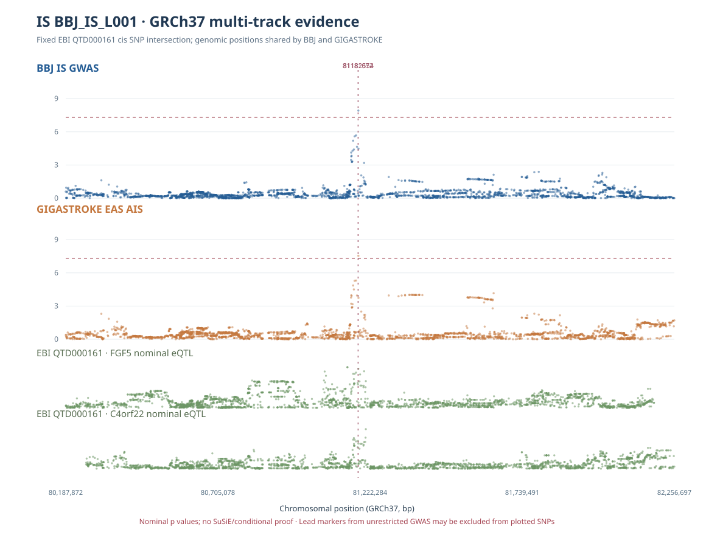
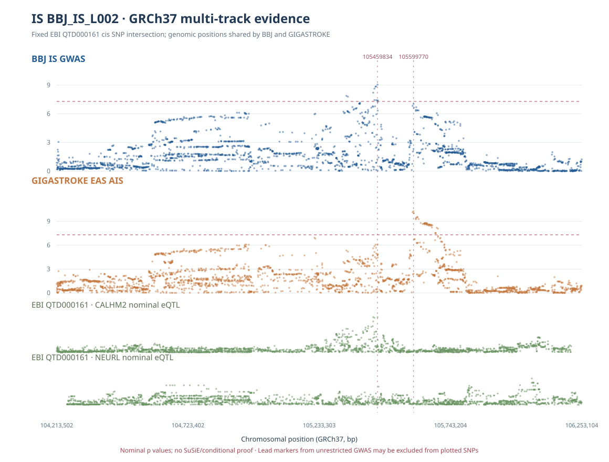

# IS chr4/chr10 GWAS–QTL multi-track evidence figures

**Audit date 2026-10-11 (KST).** Two reproducible GRCh37 genomic-coordinate figures combine allele-harmonized evidence from (i) BBJ ischemic stroke GWAS, (ii) GIGASTROKE EAS AIS GWAS, and (iii) EBI QTD000161 nominal GTEx cerebellar-hemisphere cis-eQTL tests. The plots are **not** formal conditional regression, multi-signal colocalization, credible sets, or causal gene assignment.

## chr4: FGF5 / C4orf22

- **2,697** unique exact-allele, non-palindromic SNPs common to both GWAS and the EBI eQTL test universe were plotted for the BBJ and GIGASTROKE marginal GWAS tracks. The bottom two tracks show the same matched molecular-eQTL SNP universe separately for FGF5 and C4orf22. SNPs in linkage disequilibrium are not independent observations.
- **BBJ full regional lead**: GRCh37 `4:81182554:T:C` with marginal p=1.2119e-8. **GIGASTROKE unrestricted regional lead**: position `4:81181072`, p=2.583e-8. The latter is palindromic A/T and is intentionally **excluded from non-palindromic scatter SNPs**; it is drawn only as a vertical reference line.
- Public-reference ALT dosage correlation between these two genomic positions is **r²=0.9420 (EAS504)** and **0.9749 (JPT104)**, consistent with strong tagging in reference genotypes. The palindromic GWAS effect strand remains unverified, and this is not the actual BBJ/GIGASTROKE cohort LD.
- Exploratory EBI–BBJ single-signal `coloc.abf` sensitivity previously produced FGF5 PP.H4≈0.913 and C4orf22≈0.421 at hypothetical molecular N=175, prior p12=1e-5, **not validated QTL effective sample N**. Figure dots show nominal marginal p, not this posterior; ABF requires separate prior/N sensitivity interpretation.

## chr10: CALHM2 / NEURL

- **2,626** unique nonpalindromic, exact-allele SNPs in the common molecular-QTL/GWAS test universe.
- **BBJ unrestricted regional lead**: `10:105459834:T:C`, p=8.762e-10; **GIGASTROKE unrestricted lead**: position `10:105599770`, p=5.584e-11. Source REF/ALT variant-ID orders differ, so matching is by position plus allele pair, not raw ID.
- Reference EAS504 **r²=0.00737** between the lead positions; this weak pairwise LD **does not demonstrate two independent causal variants**. Strong single-variant marginal evidence in different study-specific lead positions and a similar overall locus direction are consistent with multiple interpretations.
- Exploratory EBI–BBJ single-signal ABF sensitivity previously yielded CALHM2 PP.H4≈0.905 and NEURL≈0.061 at hypothetical QTL N=175 / p12=1e-5. These values **do not represent a SuSiE multicausal fit** and cannot resolve competing regional signals without ancestry/study-appropriate LD and validated QTL N.

## Plot construction and scientific boundaries

The shared evidence source is `IS_PRIORITY4_FULLCIS_EBI_BBJ_GIGASTROKE_SNP_EVIDENCE.tsv` with **20,689 gene–variant rows**. Every point requires previous allele/FASTA verification in both GWAS and exclusion of palindromic variants; unique GWAS SNPs are deduplicated by GRCh37 position and alleles to avoid double-counting the two genes sharing a locus. The QTL tracks remain **gene-specific**. Genomic x-axes reflect each locus's common-SNP coverage, not independent recombination blocks.

Dotted horizontal lines on GWAS panels are the conventional marginal genome-wide threshold p=5×10⁻⁸; axes show −log10(p). The eQTL panels show **nominal** p-values, not multiplicity-adjusted QTL association claims. Vertical markers indicate lead genomic positions from the **unrestricted original full regional GWAS source**, which may not appear as dots in this plot's restricted SNP set. Lack of a plotted point never means a GWAS variant is absent or nonsignificant.

The figure cannot independently corroborate the lead's causal status; formal BBJ–GIGASTROKE multi-signal/conditional analysis remains limited by absence of large, well-matched Japanese cohort LD and molecular study-donor LD. The original 2,225 broad IS genes, historical 646 coloc outputs, and 120 new ABF sensitivity scenarios have not been modified.

Reproduction:
- `scripts/is/render_is_priority4_locus_multitrack.py`
- Server outputs: `/srv/is-analysis/results/is/audits/is_priority4_locus_multitrack_20261011_v1/`.
