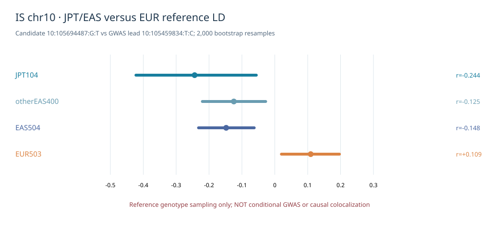

# IS chr10 — 1000 Genomes JPT104 reference LD and bootstrap audit

**Audit date:** 2026-10-11 KST. This is a **genotype-reference-only** LD sensitivity study. It is **not** an in-sample BBJ GWAS conditional analysis, a GTEx QTL cohort LD analysis, a SuSiE fine-mapping fit or a causal colocalization claim.

## Population provenance

We used the existing 1000 Genomes Phase 3 annotation `integrated_call_samples_v3.20130502.ALL.panel` to recover exactly **104 Japanese in Tokyo, Japan (JPT)** individuals within the locally verified 504 EAS reference participants. The other **400 EAS individuals** are explicitly disjoint from JPT. The independent EUR panel has **503** individuals. **EAS504 includes JPT104**, so EAS and JPT are not independent cohorts. The relevant `1000 Genomes Phase 3` official population information is available from IGSR: https://www.internationalgenome.org/data-portal/data-collection/phase3 and https://test.internationalgenome.org/data-portal/population/JPT.

Genomic keys are the exact GRCh37 `chr:pos:REF:ALT`; both sources were converted from PLINK's recorded counted allele to **ALT dosage** before computing signed Pearson LD. Existing JPT-containing EAS PGEN and newly downloaded full-cis EAS504 VCF were directly cross-checked at both lead and candidate: **identical ALT genotypes for all 504 sample IDs**.

## Main chr10 candidate

Candidate `10:105694487:G:T`, BBJ GWAS lead `10:105459834:T:C`, marginal BBJ GWAS z=+4.832637, lead z=−6.130469.

| Panel | n | Signed r | r² | Candidate ALT frequency | Heuristic z after lead, alpha=.05 |
|---|---:|---:|---:|---:|---:|
| JPT104 | 104 | **−0.243875** | 0.059475 | 0.399038 | **3.5078** |
| non-JPT EAS400 | 400 | −0.124580 | 0.015520 | 0.410000 | 4.1362 |
| EAS504 | 504 | −0.147903 | 0.021875 | 0.407738 | 4.0111 |
| EUR503 | 503 | **+0.109206** | 0.011926 | 0.347913 | **5.4983** |

All five pre-specified shrinkage alpha settings (0, .01, .05, .10 and .20) gave **zero** JPT variants above the earlier exploratory absolute-z threshold 5.45 within either locus. At chr10, EUR503 produced one threshold crossing at alpha 0–.10 and none at alpha .20. A zero exploratory residual screen is *not* proof of absent secondary causal signals.

### 2,000 bootstrap resamples per population

We resampled **individual genotype pairs** with replacement with random seed `20261011`. With alpha=.05, percentile intervals describe reference-genotype sampling variability. GWAS z values were held fixed; they were **not** sampled as GWAS uncertainty.

| Panel | Reference r 95% bootstrap interval | Heuristic residual z 95% bootstrap interval | Bootstrap fraction above abs(z) 5.45 |
|---|---|---|---:|
| JPT104 | **[−.4223, −.0562]** | **[2.591, 4.511]** | **0/2000** |
| non-JPT EAS400 | [−.2203, −.0278] | [3.630, 4.673] | 0/2000 |
| EAS504 | [−.2319, −.0626] | [3.570, 4.476] | 0/2000 |
| EUR503 | **[+.0201, +.1966]** | **[4.951, 6.084]** | **1,136/2,000 (56.8%)** |

The 95% percentile interval for `r_JPT−r_EUR` is **[−.5505, −.1527]**, while the interval for `r_JPT−r_nonJPT_EAS` is **[−.3243, +.0989]**. Thus the latter is not clearly distinguished from zero under this reference-only bootstrap. The reported JPT-versus-EUR difference does not prove a biological ancestry-specific causal mechanism.

## Entire chr4/chr10 exploratory screening

The source was the previously audited BBJ IS and EBI QTD000161 shared biallelic SNP table. At every EUR/EAS genotype intersection, no input SNP, GWAS beta/SE or GWAS p-value was changed. The approximate score is `z_res=(z_j−(1−alpha)*r_jL*z_L)/sqrt(1−((1−alpha)*r_jL)^2)`. The lead itself and monomorphic SNPs are excluded; **this z is not a calibrated conditional GWAS statistic**.

| Locus | JPT evaluable SNPs per alpha | JPT above threshold for all five alpha | non-JPT EAS | EAS504 | EUR503 |
|---|---:|---|---|---|---|
| chr4 FGF5/C4orf22 | 2,787 | 0 / 0 / 0 / 0 / 0 | 0 / 0 / 0 / 0 / 0 | 0 / 0 / 0 / 0 / 0 | 0 / 0 / 0 / 0 / 0 |
| chr10 CALHM2/NEURL | 2,665 | **0 / 0 / 0 / 0 / 0** | 0 / 0 / 0 / 0 / 0 | 0 / 0 / 0 / 0 / 0 | **1 / 1 / 1 / 1 / 0** |

JPT has more monomorphic or low-frequency variants than EAS504 at some sites and must not be treated as coverage-equivalent. The differing numbers of evaluable SNPs do not create signals at the candidate, which was present, callable and polymorphic in every group.

## Interpretation and figure

The EUR-only candidate should **not be promoted as an independent BBJ ischemic stroke signal**. A population-reference change can alter the sign of low-magnitude LD and the apparent residual. The 2,000-bootstrap fraction is conditional on the fixed BBJ marginal z and the resampled public genotypes; 0/2000 is not a zero population probability, and 56.8% in EUR is not a replication probability.

## Reproducibility and evidence gates

Code: `scripts/is/audit_is_priority4_jpt_bootstrap.py`; visualization: `scripts/is/render_is_priority4_jpt_bootstrap.py`; tests: `tests/test_is_priority4_jpt_bootstrap.py`.

Research server output: `/srv/is-analysis/results/is/audits/is_priority4_jpt_bootstrap_20261011_v1/` containing locus QC, ancestry-dependent alpha screen, candidate alpha table, 2,000-replicate bootstrap summary and a noncausal manifest.

**Future gate:** real cohort-calibrated BBJ conditional GWAS / ancestry-appropriate cohort LD, study donor-specific GTEx QTL LD, and separately validated expression-effective QTL N. The historical 646 coloc results, new ABF 120 scenarios and the entire 2,225-gene discovery universe are unchanged.
