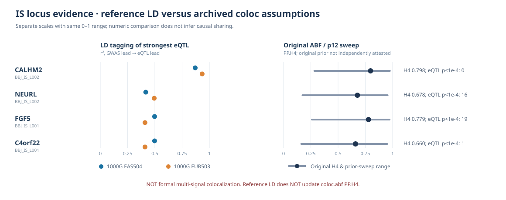

# IS ancestry-dependent LD proxy neighborhoods and archived ABF interpretation

**Audit date:** 2026-10-11 KST. **Source:** two BBJ stroke loci, four GTEx cerebellar-hemisphere gene–tissue assays, and the same previously checked 1000 Genomes EAS504/EUR503 GRCh37 ALT-dosage reference genotypes. The existing **2,225-gene discovery universe is unchanged**.

## Question and valid analysis boundary

We asked whether GWAS-lead tagging patterns across an entire locus, including nominal molecular QTL evidence, remain similar in East Asian and European reference groups.

**This is not a recalculation of PP.H4.** Standard `coloc.abf` takes aligned association summaries, sample N, allele frequencies and priors and assumes at most one causal association signal per trait, but **does not accept an LD matrix**. Consequently, changing the EAS versus EUR *reference* LD matrix cannot be assigned a numeric PP.H4 change. The diagnostic here compares LD proxy and nominal-eQTL neighborhoods only; it cannot validate sharing of a causal SNP or multiple independent signals.

## Whole-source-SNP reference LD comparison

| Locus | Source matched SNPs | Informative LD both groups | High tagging r²≥0.8 both | High only EAS | High only EUR | SNPs `abs(delta r²)>0.2` | Median abs(delta r²) |
|---|---:|---:|---:|---:|---:|---:|---:|
| chr4, BBJ_IS_L001 | 1,694 | 1,659 | 5 | 0 | 1 | 22 | 0.00212 |
| chr10, BBJ_IS_L002 | 1,583 | 1,568 | 4 | 2 | 1 | 72 | 0.00726 |

The 0.8 cutoff is a **descriptive lead-SNP tagging convention**, not an established multi-signal or colocalization threshold. Every high-tag count includes the reference GWAS lead where informative. No SNP was counted as absence of LD if one reference r² was uninformative. Signed-r direction reversal counting required nontrivial absolute r≥0.2 in both groups; none met that criterion in these lead-anchored comparisons.

**Important denominators:** 3,277 distinct matched SNP rows across 2 loci, 3,227 informative in both ancestries. These are **original archived common-input SNP intersections**, not a verified complete cis-QTL tested-variant universe, and counts are not independent genome-wide discoveries.

## Highest nominal molecular QTL variant compared with GWAS lead

Tissue: GTEx v8 brain cerebellar hemisphere, archived SNP intersection only. Each strongest QTL variant is the minimum nominal eQTL p in those rows, not a conditionally independent fine-mapped lead.

| Gene | Original archived PP.H4 | Top QTL nominal p | EAS lead-pair r² | EUR lead-pair r² | QTL SNPs p<1e-4 in archived source set | Among those, r²≥0.8 with GWAS lead **in both** |
|---|---:|---:|---:|---:|---:|---:|
| FGF5 | 0.7787 | 1.0257e-6 | 0.4976 | 0.4095 | 19 | 1 |
| C4orf22 | 0.6599 | 2.26293e-6 | 0.4976 | 0.4095 | 1 | 0 |
| CALHM2 | 0.7977 | 1.3617e-4 | 0.8700 | 0.9336 | 0 | 0 |
| NEURL | 0.6776 | 5.66816e-6 | 0.4165 | 0.4942 | 16 | 1 |

This is informative because CALHM2's strongest molecular SNP is **highly correlated** with the GWAS lead in both 1000G reference groups, but its strongest *nominal* eQTL p within this archived subset is only 1.36e-4. In contrast, FGF5 and NEURL have smaller eQTL p-values at other SNPs, and most such SNPs are **not strongly tagged** by the GWAS lead. Neither condition proves that an independent molecular signal exists, nor that shared causal variation is present or absent.

## Prior-sensitivity context (not driven by LD)

The earlier archived PP.H4 values vary substantially when prior p12 is *conditionally reweighted* over 1e-6 to 1e-4. For these gene/tissue pairs:

| Gene | Archived PP.H4 | Conditional p12-grid PP.H4 range |
|---|---:|---:|
| CALHM2 | 0.7977 | 0.2828–0.9753 |
| FGF5 | 0.7787 | 0.2603–0.9724 |
| NEURL | 0.6776 | 0.1737–0.9546 |
| C4orf22 | 0.6599 | 0.1625–0.9511 |

The original historical p12 execution provenance has **not** been independently verified. QTL per-SNP N varies and previous GTEx vs BBJ minor allele frequencies differ across cohorts. These sensitivities are independent reasons not to overstate the archived ABF PP.H4.

## Integrated figure

The left panel shows r² between the GWAS lead and each gene's strongest archived QTL SNP in EAS and EUR. The **separate** right panel shows the original ABF PP.H4 and prior-reweighting range. Their 0–1 scales are visually comparable but **scientifically different metrics**; no mechanistic transformation or relationship from r² to PP.H4 is claimed.

## Reproducible source and audit outputs

- Detailed per-locus 3,277 SNPs, 4 gene–tissue summaries, and 80 strongest nominal-eQTL SNP tag rows:
  `/srv/is-analysis/results/is/audits/is_priority4_ld_proxy_ancestry_stability_20261011_v1/`
- Joined original posterior, conditional prior reweighting, and reference-LD read-only context:
  `/srv/is-analysis/results/is/audits/is_priority4_ld_coloc_assumption_context_20261011_v1/`
- Executable, fail-closed code:
  `scripts/is/audit_is_priority4_ld_proxy_ancestry_stability.py`
  `scripts/is/build_is_priority4_ld_coloc_assumption_context.py`
- Regression tests in `tests/test_is_priority4_ld_proxy_ancestry_stability.py` and `tests/test_is_priority4_ld_coloc_assumption_context.py`.

**Next scientific gate:** retrieve cohort-appropriate molecular LD, independently resolve SNP orientation/variant universe and QTL sample N, then attempt conditional or `coloc.susie` with legitimate matching assumptions. Never use 1000G EAS as GTEx EUR cohort LD; never call this reference overlap test a validated shared causal variant.
