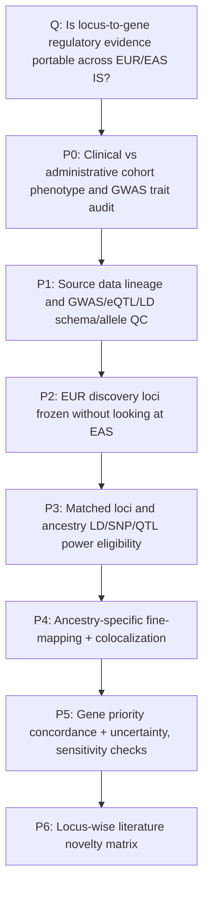

# IS EUR–EAS regulatory genomics: protocol architecture V1 (2026-11-11)

> **Status: design contract validated pending CI; SCIENCE HOLD.** This is an internal protocol/workflow plan, not a submission artifact. The course Research Proposal form explicitly prohibits AI-written submissions. The student must independently write any submitted content.

## Executive decision

**Primary research goal:** Evaluate whether independent EUR-discovered ischemic-stroke (IS) risk loci lead to reproducible gene prioritization when paired with ancestry-matched EUR or EAS whole-blood cis-eQTL evidence. Ancestry comparison must explicitly consider phenotype ascertainment, association power, allele/LD coverage, eQTL sample size and SNP overlap.

**Hypothesis (testable, *not yet supported*):** At a subset of loci analyzable in both populations, ancestry-matched GWAS + cis-eQTL may yield different locus-to-gene evidence. Differences can indicate genuine genetic architecture differences **or** technical/source confounding. The null is full concordance within uncertainty.

**Not part of this protocol:** 6-month progression, response, patient-level prognosis, incident risk prediction model/AUC, treatment outcome, clinical risk score, matched imaging/omics, patient-matched GWAS/eQTL, causation from colocalization, or a claim that ancestry *causes* expression changes.

## 1. Argument chain: every method answers one question



An arrow means the downstream conclusion is not justified until the upstream gate is documented. Phenotype review is **not** a pretense to retroactively adjudicate consortium patients. EAS GWAS trait metadata passing does not allow a source phenotype gate to pass.

| Layer | Input | Unit | Primary output | Failure handling |
|---|---|---|---|---|
| P0 phenotyping | Final GIGASTROKE supplement + per-cohort recruitment criteria | contributing cohort × outcome × ancestry | source/ascertainment matrix, sample overlap uncertainty | **HOLD phenotype comparability** |
| P1 provenance | EUR IS, EAS IS sumstats; whole-blood cis-eQTL, EUR/EAS LD | dataset | checksums, file headers, genome build, allele coding, raw QC | **HOLD data** |
| P2 locus selection | EUR discovery GWAS only | independent locus | locked independent locus list + window/gene annotation | no fishing in EAS |
| P3 eligibility | EUR/EAS SNP universe, MAF, INFO, LD, eQTL depth | locus–gene × ancestry | analyzable BOTH/EUR-only/EAS-only/neither; reasons | unknown ≠ negative |
| P4 colocalization | comparable within-ancestry GWAS/QTL, LD | locus–gene–ancestry | PP(H3), PP(H4), credible sets + sensitivity | unresolved if weak/QC failure |
| P5 evidence comparison | paired locus–gene results | independent locus | concordant/different/unresolved fraction with denominator | no ethnicity-causal inference |
| P6 novelty | original IS/eQTL papers | locus–gene × reported claim | previously known vs genuinely added vs unknown | no unsupported novelty |

### Why one primary hypothesis is essential

A 3–12 month proposal should not declare 5 equal aims (pQTL MR, TWAS, drug target screening, cell-type enrichment, prediction). Those approaches answer different questions and add unverified assumptions. **Primary**: GWAS/eQTL gene priority portability. **Secondary**: IS subtypes and biological annotation *only if primary gates pass*. **Exploratory**: AF/CE contextual relevance; EAS CE (926 cases) is not a primary powered comparison.

## 2. Exact populations, outcomes, and independent validation

- **EUR discovery:** confirmed EUR *ischemic stroke* GWAS, source accession/method and cohort overlap to be filled only after verifying original summary statistics. Its accession is deliberately **UNVERIFIED** in the contract.
- **EAS assessment:** GIGASTROKE GCST90104545 (19,032 published cases, 237,242 controls). This is an ancestry-specific *assessment* from the same consortium; not independent external replication.
- **Secondary:** EAS small-vessel subtype GCST90104548 (5,532 cases); EAS cardioembolic subtype GCST90104546 (926 cases) only exploratory. Subtypes may be nested in IS.
- **Negative phenotype**: GCST90104544 means **any stroke**, includes hemorrhage/unknown; NEVER silently substitute for IS. Clinical outcomes are genetic liability to case-control diagnosis, not prognosis.
- **No patient matching:** GWAS case-control participants and eQTL donors are separate studies. Integration is by variants and loci, not individual imaging/tissue records.
- **Phenotype ascertainment risk:** BBJ physician/TOAST, Japanese stroke registries clinician/CT/MRI versus CKB/KCPS2 registry/ICD recorded in the GIGASTROKE *preprint* supplement; consortium accession-specific cohort weights remain unknown. Source: [stroke_diagnosis_pheno_ancestry_protocol_2026-11-11.md](stroke_diagnosis_pheno_ancestry_protocol_2026-11-11.md).

## 3. Comparison estimand and non-identifiability

**Primary analysis unit = independent GWAS locus**, not number of people or number of genes.

After EUR selection, for each locus construct paired set with matched tissue, gene identifiers, SNP coordinates, harmonized effects and imputation. Run within-EUR GWAS+EUR blood cis-eQTL/LD and within-EAS GWAS+EAS blood cis-eQTL/LD **separately**. Do **not** use EUR LD with EAS or treat such cross-population swapping as a controlled experiment. Capture:

- Total EUR preselected loci (**N_total**); loci covered in both populations (**N_eligible**); coverage N_eligible/N_total; separate non-evaluable reasons.
- At each *eligible* locus, whether robust credible-set/colocalization evidence supports the same highest-priority gene, different gene, or unresolved results; report all three and N denominator.
- Difference in prioritization support *conditional on matched coverage*, EAS effective N and power; no claim of a statistically proven ancestry effect from a difference between two P values or posterior probabilities alone.
- Confidence intervals across independent loci (e.g. proportion interval or locus-level bootstrap, adjusted to nonindependence if nearby loci are correlated); prespecify how tied genes are handled.
- PP3 and PP4 (not PP4 alone), sensitivity to priors, multiple independent signals, SNP overlap and fine-mapping calibration. Do not convert expression presence to a causal gene.
- If either ancestry lacks an informative eQTL dataset or sufficiently powered GWAS at a locus, label **NON_EVALUABLE** rather than biological disagreement.

The key scientific uncertainty is *identifiability*: heterogeneous diagnosis, eQTL sample size, cohort composition, LD and allele frequency are not randomized. Without individual-level or cohort-specific summary data, some ancestry-versus-ascertainment components cannot be separated. **Explicit limitation**, not an invented adjustment.

### Acceptable analysis versus impermissible overinterpretation

| Observation | Permitted statement | Not permitted |
|---|---|---|
| EUR eQTL PP4 high; EAS eQTL PP4 low | Different strength of regulatory evidence in these sources | EAS gene has no regulatory mechanism |
| GWAS EAS P>0.05 | Insufficient EAS statistical support | Genetic effect absent in EAS |
| Blood and atrial scRNA express gene | Tissue/cell context for prioritization | Variant specifically regulates those cells |
| Strong coloc H4 | Data consistent with shared variant(s) | Expression causally mediates stroke |
| EUR and EAS analyses both use GIGASTROKE | Cross-ancestry within-consortium result | External independent validation |

## 4. False-positive and reviewer-defense safeguards

1. **Study design freeze:** preserve EUR locus selection rule, genome build, windows, cis-gene list, priors, quality cutoffs, rank ties, PP threshold and target primary comparison in a versioned commit **before** results.
2. **Clinical phenotype:** retrieve final Nature supplementary study definition file. For each source cohort, identify clinical/CT/MRI/TOAST vs ICD/claims, case/control sampling, prevalent/incident, and any non-ischemic categories. If unavailable, annotate UNKNOWN and never infer equivalent diagnosis.
3. **No leakage:** no use of EAS evaluations to identify EUR discovery loci; do not relabel re-analysis of the same consortia as independent replication.
4. **Assay and population differences:** eQTL from whole blood; heart/brain expression only optional annotation; study N/ancestry matching, cis-window, variant capture and covariates matter.
5. **Power and multiple testing:** precompute effective N and locus-specific detectability, address multiple gene tests; avoid arbitrary 80% PP4 rule without prior sensitivity and PP3 comparison. 
6. **Novelty falsification:** prior study claims for *exact locus, gene, trait, ancestry, method, tissue* must be checked. GIGASTROKE 2022 already did cross-ancestry eQTL/pQTL and fine-mapping, GBMI 2023 reported ABO/ALDH2 patterns, and 2024 stroke subtype cell-specific eQTL coloc exists.
7. **Reporting:** evidence tables must distinguish PASS, PARTIAL_HOLD, HOLD, BLOCKED, STOP, SOURCE_UNAVAILABLE and NON_EVALUABLE. CI success is only process validity.
8. **Stop rule:** no full EAS cis-eQTL and matched LD => STOP primary cross-population gene priority comparison; proceed with clearly labelled EUR-only interpretation and EAS GWAS direction check only if justified.

## 5. Versioned files and execution boundaries

| File | Role |
|---|---|
| `config/research/is_eur_eas_regulatory_v1.json` | Machine-readable sources, research question, primary endpoint, six stages, six gates |
| `data/metadata/stroke_eas_phenotype_register_2026-11-11.json` | Registered EAS phenotypes with explicit diagnostic unknowns |
| `scripts/is/validate_is_eas_study_design.py` | Enforce cohort, endpoint, provenance, no-leakage and gate invariants |
| `tests/is/test_is_eas_study_design.py` | Deliberately corrupt contract to ensure inappropriate claims fail |
| `.github/workflows/is_eas_metadata_audit.yml` | Run metadata + phenotype + study design audits; publish artifacts |
| `docs/research/stroke_diagnosis_pheno_ancestry_protocol_2026-11-11.md` | Clinical definitions and cohort ascertainment review |

### Minimal output lineage after sourcing full data

```text
artifacts/is_eas_study/
  provenance/   dataset_manifest.json, sha256.tsv, cohort_map.tsv
  qc/           gwas_qc.json, eqtl_qc.json, ld_qc.json
  loci/         frozen_eur_loci.tsv, paired_loci_eligibility.tsv
  coloc/        locus_gene_coloc.tsv, posterior_sensitivity.tsv
  synthesis/    paired_locus_concordance.tsv, novelty_matrix.tsv
  reporting/    gate_status.json, audit_evidence.md
```

Do not commit potentially restricted GWAS/eQTL raw archives, Synapse credentials, patient-level files or API keys. CI should publish only lightweight non-identifying checks and permitted aggregate evidence.

## 6. Six-month milestone framework (flexible to 3–12 months)

| Month | Planned milestone | Required evidence | Change of direction |
|---|---|---|---|
| 1 | P0/P1 complete: final supplementary phenotype table, source file audit | cohort×trait matrix; genome build/allele fields; checksums | insufficient phenotype evidence → report limitation |
| 2 | P2: full EUR/EAS eQTL and LD access, samples/power | pairwise availability and power report | source absent → EUR-only alternative |
| 3 | P3: independent EUR discovery loci frozen and pairwise eligibility | prelocked loci + SNP/LD coverage | too few evaluable loci → feasibility STOP |
| 4 | P4: fine-mapping/coloc with prior sensitivity | PP3/PP4, credible-set QC, reproducible logs | unstable inference → descriptive results only |
| 5 | P5: paired locus-gene evidence, robustness | coverage-adjusted concordance/uncertainty tables | confounding dominates → restrict claims |
| 6 | P6: prior-work novelty audit and independent evidence | gene/locus publication matrix; reproducibility package | no novel contribution → reposition or STOP |

Timing is a planning framework, not a guarantee that gated analyses can be performed.

## 7. Gate decision at this commit

- **G0 PARTIAL_HOLD**: published case definitions partially checked; accession-specific cohort membership not verified.
- **G1 HOLD**: full GWAS summary files unverified.
- **G2 HOLD**: full ancestry-specific eQTL and LD not yet audited.
- **G3/G4/G5 BLOCKED**: downstream science cannot start legitimately.

**Current result: DESIGN_READY_FOR_AUDIT; NOT DATA-READY, NOT SCIENTIFICALLY VALIDATED.**

### Literature

- Mishra et al. 2022 GIGASTROKE: https://doi.org/10.1038/s41586-022-05165-3
- Wallace 2021 coloc–SuSiE: https://doi.org/10.1371/journal.pgen.1009440
- Shen et al. 2026 multi-ancestry colocalization methods: https://doi.org/10.1371/journal.pgen.1012221
- Stroke subtype sc-eQTL 2024: https://pubmed.ncbi.nlm.nih.gov/38744227/
- Sacco et al. 2013 AHA/ASA definition: https://doi.org/10.1161/STR.0b013e318296aeca
