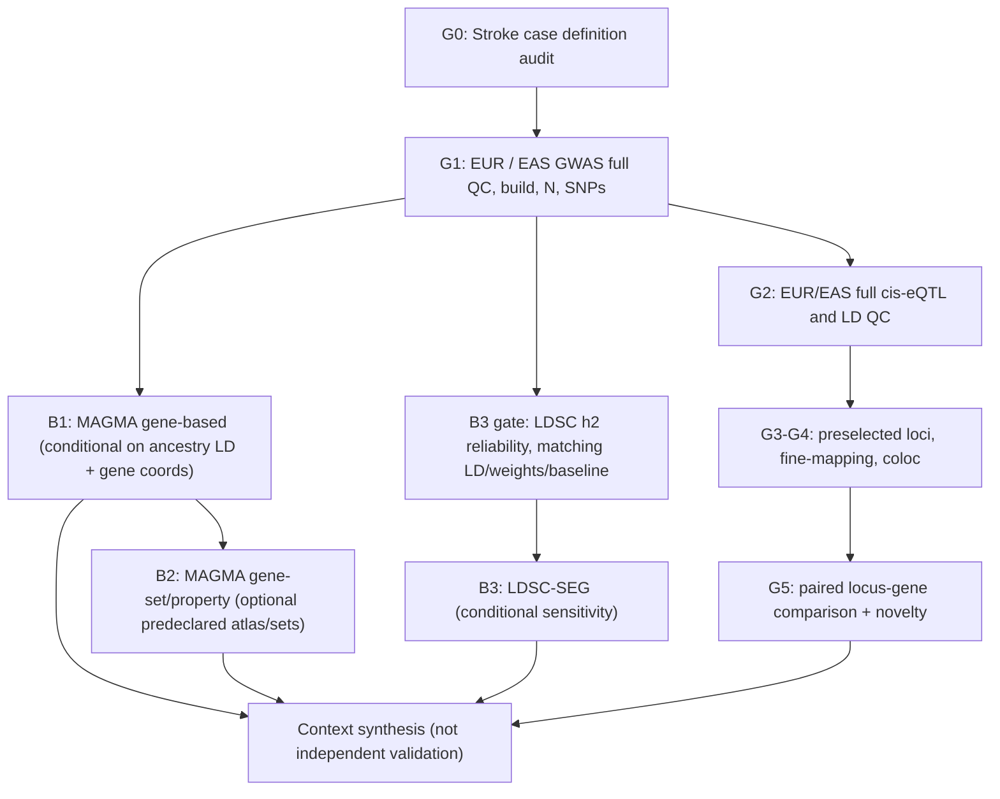

# Decision memorandum: MAGMA and LDSC-SEG as auxiliary layers for EUR–EAS ischemic stroke

**Internal methods review, 2026-11-11.** This is research scaffolding, not a submitted course proposal (the supplied form explicitly disallows AI-generated submission content). This document records *why* a method may be run, what it estimates, when to decline it, and how it relates to the pre-existing primary question.

## Frozen conceptual hierarchy

**Primary outcome and estimand remain unchanged:** ischemic-stroke susceptibility in EUR/EAS GIGASTROKE (EUR GCST90104540; EAS GCST90104545), locus-level concordance of ancestry-matched GWAS–blood cis-eQTL prioritization where both populations are evaluable. This is *not* 6-month progression, prognosis, or treatment response. Clinical/administrative case ascertainment varies across cohorts. No patient-level matched omics or independent replication is being claimed.

**Decision:** add MAGMA gene-based as a SECONDARY genomic-context analysis, MAGMA gene-property as OPTIONAL tissue/cell-context analysis, and LDSC-SEG only as a CONDITIONAL sensitivity module. None is an independent cohort or proof of causation. They reuse primary GWAS inputs; agreement between them is **not independent replication**.

| Method | Specific question | Input | Unit of inference | Permissible result | What it cannot establish |
|---|---|---|---|---|---|
| MAGMA gene-based | Which genes carry aggregate IS GWAS association after accounting for LD? | Genome-wide ancestry-specific GWAS P/N, frozen gene coordinates + ancestry-specific LD reference | gene × ancestry | Gene-level P and adjusted Q, same gene universe/coverage for comparison | Causal gene, functional mediator, co-localized GWAS–QTL variant |
| MAGMA gene set | Are predeclared pathways disproportionately associated beyond baseline gene signal? | MAGMA genome-wide gene results + frozen curated pathways | gene set × ancestry | Competitive gene-set statistics with FDR and confounder control | Pathway activation or therapy target |
| MAGMA gene-property | Does IS gene association correlate with tissue/cell type-specific expression? | Full gene results + external tissue/scRNA specificity atlas and gene IDs | tissue/cell type × ancestry | Gene-property coefficient/SE/P/Q (conditional for correlated types if used) | Genetic effects in those cells or a causal variant-specific regulatory mechanism |
| LDSC-SEG | Is SNP heritability concentrated in annotations near genes specifically expressed in selected tissues/cells? | Full GWAS (not only loci), compatible population-specific annotation LD scores/weights/frequency and baseline model | annotation × ancestry | Conditional tissue/annotation coefficient, SE, enrichment/P/Q with reliability diagnostics | Fine-mapping, gene mediation, variant-level colocalization or person-level validation |
| Core eQTL colocalization | Is GWAS association consistent with same genetic signal as gene regulation in a tissue? | Population-matched GWAS and full cis-eQTL with LD | locus–gene × ancestry | PP(H3), PP(H4), credible sets and sensitivity | Causal mediation without separate perturbation/instrumental evidence |

### Evidence/recommendation rationale

- de Leeuw et al., *PLoS Computational Biology* 2015 (https://doi.org/10.1371/journal.pcbi.1004219) introduced MAGMA's gene and gene-set regressions; gene-level signals are statistical associations.
- Finucane et al., *Nature Genetics* 2018 (https://doi.org/10.1038/s41588-018-0081-4) introduced LDSC-SEG; annotation-conditioned **SNP-heritability enrichment** is distinct from gene expression differential expression.
- Watanabe et al., *Nature Communications* 2019 (https://doi.org/10.1038/s41467-019-11181-1) used MAGMA gene-property for single-cell gene specificity and stressed batch/annotation effects and different hypotheses from LDSC.
- Wang et al., *Genes* 2026 (https://doi.org/10.3390/genes17091061) performed MAGMA and stratified tissue LDSC in ischemic-stroke/CAD genetics. **Neither analysis method is novel by itself.**

## Workflow and decision dependencies

**Parallelism:** MAGMA can run while eQTL access remains on HOLD after the appropriate GWAS/LD files pass. Do not claim that MAGMA resolves G2 or that any tissue module unlocks colocalization. If all optional modules fail feasibility, the core primary research question stays intact.

### Predeclared tissue/context panel (candidate only)

GTEx tissue labels to verify explicitly in the selected atlas: Artery_Aorta, Artery_Coronary, Artery_Tibial, Heart_Atrial_Appendage, Heart_Left_Ventricle, Whole_Blood, Brain_Cortex, Brain_Cerebellum. These are *candidates*, not confirmed atlas availability. A separate disease-relevant scRNA atlas might provide vascular endothelial, vascular smooth muscle/pericyte, immune/myeloid and neural/glial cells; do not imply these all exist as common shared categories or that atlas tissue is matched to GWAS participants.

Rationale: IS is a clinical brain infarction outcome but may result from vascular/atherosclerotic, cardioembolic, hematologic, small-vessel and neurological biology. Testing only neuronal expression could mask extracerebral etiology; testing every tissue post hoc would inflate false discoveries. Freeze predeclared atlas IDs, gene annotation build and tissue tests before inspecting results.

### Data interpretation and quality gates

1. **G0/G1 phenotype & source:** only ischemic stroke GWAS accession (EUR GCST90104540; EAS GCST90104545); verify original summary statistics format, genome build, alleles, per SNP N, QQ/GC, imputation. Do not substitute any-stroke phenotype.
2. **MAGMA:** use source-matched EUR/EAS LD (e.g. appropriately QC'd 1000 Genomes ancestry subset), report LD sample size, variant coverage, build and gene coordinate version. Record gene windows before results. Use FDR/Bonferroni across tested genes; for gene sets record curated gene sets, their versions, whether competitive/self-contained and overlap, and correction within prespecified families.
3. **MAGMA property:** use *all* analyzable genes (not only coloc-positive or DEG hits); gene length, density and correlated gene effects handled by method; expression library origin, cell n, batch handling and specificity transformation pinned. Expression panel's ancestry cannot be assumed to be the GWAS ancestry.
4. **LDSC-SEG:** must have genome-wide GWAS and trustworthy h² Z/SE; precomputed EUR partitioned-LDSC annotation scores **must not** be reused for an EAS enrichment result. Recalculate or obtain EAS-compatible annotation LD scores, frequency file, weights and baseline model aligned to genome build and SNP universe. Log intercept, mean chi², h², h² Z, instability, conditional coefficient, enrichment, SE and P (with FDR). The operational h² Z ≥4 screening heuristic is **not a universal guarantee**; inspect sensitivity and available variants, and decline unreliable EAS analysis.
5. **Cross-ancestry comparison:** use matched gene/tissue sets, genome build, panel ancestry, SNP universe and comparable uncertainty. Do not call P<0.05 in EUR and P>0.05 in EAS a population difference. No direct effect contrast unless estimators and covariance permit one. Treat unknown phenotype ascertainment as an uncorrected limitation if cohort-level stratification unavailable.
6. **Negative outcome is informative:** no EAS LDSC-SEG or MAGMA signal after inadequate power is **NON_EVALUABLE**, not absent biology; predeclare restricted-scope output. Different tissue signals may be attributable to tissue atlas composition or GWAS power. Multiple tests control separate predefined families and disclose exploratory status.
7. **Conditional agreement is not independent validation:** gene-property, LDSC and coloc can all use the same GIGASTROKE GWAS source. Cross-method consistency is *triangulation of dependent evidence* only.
8. **Novelty control:** MAGMA, LDSC-SEG, stroke tissue specificity, and generic cross-ancestry differences are not novel per se. Any new finding must have locus/gene/ancestry/tissue-specific prior-publication review and robustness evidence.

## Readiness decisions as of 2026-11-11

| Module | EUR readiness | EAS readiness | Initial decision |
|---|---|---|---|
| MAGMA gene-based | HOLD (raw GWAS/LD/annotation unavailable or unverified) | HOLD | **ADD secondary** once source QC passes |
| MAGMA gene-property | HOLD (gene-wide results and atlas unverified) | HOLD | **OPTIONAL context** after gene analysis |
| LDSC-SEG | HOLD (whole-GWAS LDSC diagnostics & reference annotations unverified) | HOLD, EAS-specific annotations essential | **CONDITIONAL sensitivity** only |
| Core EUR/EAS eQTL coloc | G1/G2 HOLD | G1/G2 HOLD | **Primary scientific inference unchanged** |

This stage only creates a reproducible **decision framework**, not a real MAGMA/LDSC result. A GitHub Actions SUCCESS confirms contract/schema tests, not that any tissue is enriched.

## Files

- `config/research/is_optional_magma_ldscseg_v1.json` – optional method roles, source prerequisites, statuses, candidate tissue panel and no-go rules.
- `scripts/is/validate_is_optional_enrichment.py` – enforces methodological constraints, emits per-module EUR/EAS readiness without faking results.
- `tests/is/test_is_optional_enrichment.py` – negative tests for ancestry LD swaps, wrong phenotype, premature PASS and scope creep.
- `.github/workflows/is_eas_metadata_audit.yml` – optional design guardrail step and artifact.
